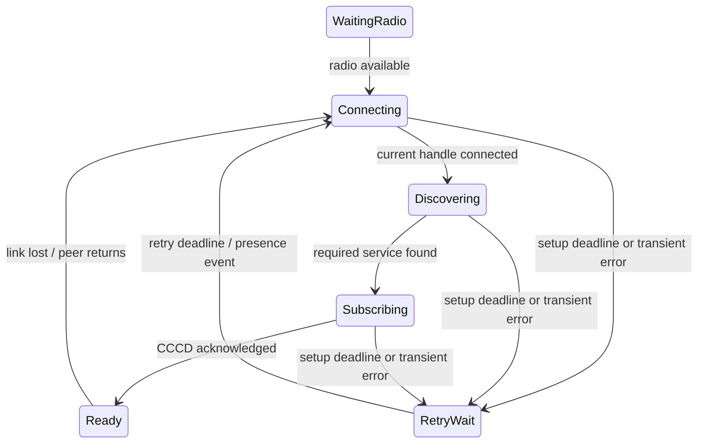

# Reliable rediscovery, reconnection, and pairing

## Status and scope

Investigation on 2026-10-18, Fedora 44 / BlueZ and the connected Samsung phone.
Android recovery repairs below are implemented and installed. Standard notification-session
ownership is implemented and radio-qualified under BUG-20261018-1736 in RPM
release 3. The earlier acquired-FD cleanup alone failed the live radio test. The remaining desktop and pairing architecture
below is a proposal, not an implemented guarantee.
Related reproduction: [BUG-20261018-1710](../bugs/BUG-20261018-1710.md).

Reconnection uses an existing bond. Pairing creates trust and requires explicit
confirmation. Losing range or switching Bluetooth off must never erase a bond,
open enrollment, or authorize an unlock. SPEC §3.2 D1–D8 and §3.3 remain the
requirements; this proposal does not approve deviations from them.

## Evidence

Times are MSK. Measurements end at successful CCCD acknowledgement, when the
phone has subscribed to desktop challenges, rather than at ACL connection.

| Experiment | Radio on | First GATT open after on | Subscription ready | Observed delay |
|---|---|---|---|---|
| Before Android repair | 17:09:37 | watchdog at 17:09:48 | 17:09:59.782 | approximately 22 s |
| Installed repair | 17:22:05 | 17:22:05.044 | 17:22:13.016 | approximately 8 s |

One cycle per build; these samples establish a recovery improvement, not a
percentile or upper bound. Physical leave-and-return, laptop radio cycling,
suspend, and BlueZ restart were not qualified in this investigation. Phone
Bluetooth was restored and the existing active bond retained. At 17:23:26 the
phone received a subsequent 33-byte challenge.

### Android recovery defects

`PersistentGattClient.kt` canceled its watchdog at `STATE_CONNECTED`, before
service discovery and notification subscription. Failed discovery or a failed
CCCD write could leave a connected but unusable client indefinitely. A null
`connectGatt()` result also left no retry. There was no radio-on event handler,
so restoring Bluetooth waited for the existing 15 s watchdog.

Closed GATT callbacks lacked handle checks, and `forceReconnect()` could revive
an explicitly stopped client. These paths have JVM regressions and repairs:

- Recovery stays armed through successful CCCD acknowledgement.
- Null and throwing opens retain a retry deadline.
- Radio off closes owned clients; radio on starts those same clients immediately.
- Bluetooth off causes no connection polling; explicit stop prevents revival.
- Callbacks from a closed handle cannot deliver challenges or cancel recovery.

The implementation retains `autoConnect=true`, `TRANSPORT_LE`, the 15 s retry
cadence, existing frame formats, and per-unlock approval. It still refreshes the
GATT cache on every connect. Replacing that hidden Android API needs a stable
desktop registration and Service Changed qualification first.

### Desktop recovery defects

`crates/syauth-transport/src/peripheral.rs` stores a notification writer after
subscription but does not monitor its closure. At 17:21:52, a subsequent unlock
hit `Broken pipe`, then `rebuild_peer_registration` registered another GATT app
at 17:21:55. This makes an authentication attempt perform transport repair.

`kick_connected_peers()` enumerates all adapter devices and disconnects every
connected device without checking syauth ownership or transport. This is a
code-level finding; the captured addresses were not identified as unrelated
peripherals. Routine recovery must not disconnect arbitrary Bluetooth devices.

The daemon does not subscribe to adapter power or BlueZ owner changes for
rehydration. In `orchestrator.rs`, `stamp_liveness()` writes `last_connect_at`
at challenge acquisition, so that status field does not prove transport readiness.

The workspace validation also exposed a lifecycle fixture opening the real
peripheral. `refuses_second_instance` exceeded its 5 s shutdown budget while
startup awaited BlueZ before polling signals. The fixture now explicitly uses
the existing fake peripheral. Production initialization still needs cancellation
and a deadline as part of adapter/BlueZ recovery.

Follow-up: BUG-20261018-1736 removes GATT rebuild from notification write failure
and monitors socket closure in the control task. Release 3 uses standard BlueZ notifications after the acquired-FD variant
failed radio qualification. A phone radio cycle recovered in approximately 3 s
without re-registration; the next real swaylock unlock succeeded through phone
approval in 2.378 s. Initial registration still calls the adapter-wide
disconnect routine; power/BlueZ rehydration and readiness diagnostics remain open.

### Pairing ownership and confirmation defects

`BluerPairBackend::scan_peers()` and `PersistentPeripheral::new()` each register
a GATT application, advertisement, and default BlueZ agent. The daemon advertises
the pair UUID continuously (`build_uuid_union`), automatically accepts numeric
comparison, and persists a `Bonded` record when the phone writes its public key
(`runtime.rs::pair_event_consumer`). That daemon path has no desktop OOB
confirmation gate and conflicts with SPEC D5.

The separately launched CLI has confirmation handling, but starting it does
not transfer ownership away from the daemon. Competing registrations are
observable in the code; which advertisement a particular picker result chose
requires a correlated radio trace. An empty phone picker alone does not prove
an advertisement format or Samsung filtering defect.

Repeated attempts also left multiple CDM associations for the same desktop.
`AndroidCdmPairCompanionScanner` starts a new association flow and cycles presence
observation for associations. Reconnection should reuse a valid association and
bond; it should not require the pairing picker.

## Proposed design

### 1. One desktop owner

Only `syauth-presenced` owns the BlueZ agent, GATT app, and advertisements.
`syauth pair` and desktop UI are clients of authenticated local IPC operations
for begin, inspect, confirm, and cancel pairing. They must not register another
default agent. Pairing is available only during an explicitly opened, expiring
session; existing bonded peers remain usable during enrollment.

### 2. Stable service, disposable connection sessions

Keep the GATT application registered across ordinary phone disconnects. Monitor
notification socket HUP and BlueZ device events, clear only the affected writer,
and accept a new notification session on resubscription. Give each session a
generation so late closure cannot clear a replacement writer. Never hold the
writer mutex while awaiting its closure. Recover a failed registration only
after an adapter/BlueZ lifecycle failure, with bounded retries.
Initialization and re-registration must be cancellable by shutdown and must not
block serving status or processing lifecycle events indefinitely.

Subscribe to adapter power, BlueZ ownership, and suspend/resume events. When
available again, reconcile one registration from persisted bond state. Respect
an intentionally disabled adapter rather than repeatedly forcing it on.

### 3. Explicit phone readiness and retry policy

Radio off moves any running state to `WaitingRadio`; explicit stop cancels all
timers and callbacks. Serialize events through one owner with an attempt
generation. Bound each setup phase rather than consuming the entire deadline
before discovery starts. Retry transient failures with capped backoff and
jitter; reset it on a genuine radio-on or absent-to-present event. Keep Android
autoConnect and CDM lifecycle support. Do not close a healthy ready link merely
because another presence callback fires. Tune retry intervals from repeated
real-radio measurements, including Doze and battery use.

Persist bond and association identity, not a claim that a socket is connected.
On process recreation, reconstruct clients and prove readiness again. Display
the actual phase, last transition, transport error, and next retry in diagnostics.

### 4. Pairing as a bounded transaction

Use explicit `Idle → Advertising → ProvisionalBonded → Bonded` states, with
cancel/expiry paths. Bind both numeric comparison and application confirmation
to one peer and session ID. Stage keys securely and permit authentication only
after both confirmations and durable commit. A GATT public-key write alone
cannot activate or replace a bond. Never reactivate a revoked peer implicitly.

Make repeated begin/confirm/commit calls idempotent. After process death, expire
unconfirmed transactions; recover a committed bond without repeating enrollment.
The phone shows success only after desktop commit acknowledgement. Reuse an
existing valid CDM association and cancel superseded picker sessions. Adding a
commit acknowledgement requires a versioned protocol/FFI change and compatibility
tests; it is not part of the installed lifecycle repair.

### 5. Separate recovery latency from approval latency

An 8 s PAM approval deadline cannot hide an unready link that needs 8 s to
recover. Keep connections ready before authentication. Report offline/recovering
accurately and preserve the configured FIDO/password fallback. A late response
must never authorize a completed or expired authentication request.

## Qualification and acceptance

| Scenario | Coverage / required outcome |
|---|---|
| Connected, discovery never completes | JVM: setup deadline retries |
| CCCD fails / succeeds | JVM: retries / cancels setup watchdog |
| Open returns null / throws | JVM: retry remains scheduled |
| Radio disabled | JVM: no opens or polling |
| Radio enabled | Service JVM: restart same owned client; one installed-phone cycle measured |
| Closed handle / explicit stop | JVM: no challenge delivery / no revival |
| Walk out of range, return after 5 min; Doze | Pending real-radio qualification; bond survives, eventual Ready without picker |
| Laptop radio off/on, suspend, BlueZ restart | Pending: one registration restored; other Bluetooth peripherals untouched |
| Subscription HUP / resubscribe | Pending desktop test: stale writer removed before next unlock; no app rebuild |
| Repeated pair, cancel, expiry, process crash | Pending: one active session/association; unconfirmed peer cannot authenticate |
| Mismatch, revoked peer, expired/replayed response | Required security regressions alongside pairing redesign |

Measure radio/presence event → GATT open → ACL connect → discovery → CCCD ack
separately from challenge → phone approval → PAM result. Collect repeated samples
and report p50/p95/max, errors and battery impact; do not infer an SLA from one
successful reconnect. Existing JVM tests do not simulate RF loss or vendor Doze.

## Sources

- [Android background BLE guidance](https://developer.android.com/develop/connectivity/bluetooth/ble/background):
  autoConnect reconnects when available; process and background lifecycle still matter.
- [Android companion pairing](https://developer.android.com/develop/connectivity/bluetooth/companion-device-pairing):
  association and observation are separate from an application GATT channel.
- [BlueZ GATT characteristic API](https://raw.githubusercontent.com/bluez/bluez/master/doc/org.bluez.GattCharacteristic.rst):
  acquired notification descriptors close on disconnect; connection sessions must
  be renewed rather than treating an old descriptor as durable.
